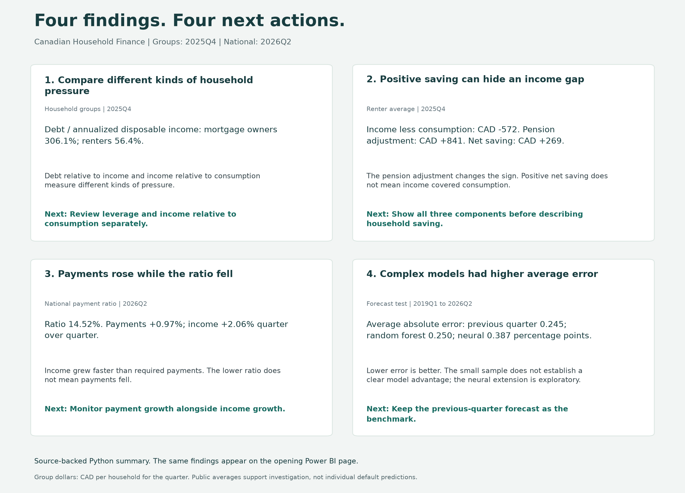

# Canadian Household Finance

A Python, SQL and Power BI project using public data to compare Canadian household debt, income and spending.

**[View the project website](https://kevinyamada.github.io/canadian-household-finance/)** · **[Download the Power BI report](https://github.com/kevinyamada/canadian-household-finance/releases/download/v1.0.0/CanadianHouseholdFinance.pbix)**

**The short answer:** Income grew faster than required debt payments, lowering the national payment ratio. Renters' positive net saving included a pension adjustment, even though consumption exceeded income. The tested complex forecasts did not beat the previous-quarter benchmark.

**Question:** Which household groups face different financial pressures, and can reporting controls catch misleading conclusions about them?

**Decision:** Review debt relative to income and income relative to consumption separately, explain the saving adjustment, and retain the simple forecast benchmark while collecting new evidence.

**Read first:** [Four insights and their actions](reports/key_insights.md) · [Next-step plan](docs/next_steps.md) · [Five-minute interview demo](docs/project_walkthrough.md)



## Four findings and what to do

| Finding | Evidence | What an analyst should do |
| :--- | :--- | :--- |
| Household groups face different pressures | **2025Q4:** mortgage-owner debt was **306.1%** of annualized disposable income, versus **56.4%** for renters | Examine leverage separately from whether income covers consumption; investigate approved portfolio evidence before customer action |
| Positive net saving did not mean renter income covered consumption | **2025Q4:** renter income less consumption was **-CAD 572**; adding the **CAD 841** pension adjustment produced **CAD 269** net saving | Show all three components and correct any description of net saving as income left after spending |
| The national payment ratio fell while payments rose | **2026Q2:** debt service was **14.52%**; payments grew **0.97%**, while income grew **2.06%** | Monitor payment growth and income growth alongside the ratio |
| Added model complexity did not lower mean forecast error | **2019Q1–2026Q2:** MAE was **0.245 pp** for the previous-quarter benchmark, **0.250** for the forest and **0.387** for the exploratory neural model | Keep the simple benchmark and assess new releases before changing it |

The group and national reference periods differ. Dollar group figures are averages in CAD per household for the quarter. These results identify reporting and investigation priorities, rather than individual borrower default probabilities. The forecast difference is uncertain in a small sample.

[Group findings](reports/segment_findings.md) · [Problem and decision](docs/problem_statement.md) · [Interview explanation](docs/interview_notes.md)

## Reporting controls and AI review

Six controls check keys, completeness, income denominators, saving identities, net worth identities and published debt ratios. Fourteen historical joint group rows have small CAD 3 net worth reconciliation differences. They remain visible as review exceptions; they are not evidence of fraud or material misstatement.

A separate Modal experiment compares Qwen3 8B and 32B under four review prompts on H100 GPUs. The evidence comes from StatCan; only the deliberately misleading report excerpts are simulated. The benchmark has 4,368 labeled cases, including 1,456 reserved evaluation cases. It compares exact checks, an AI reviewer and a combination, reporting false alarms and abstentions as well as detection.

[Benchmark protocol](docs/audit_protocol.md) · [Saved benchmark findings](reports/audit_benchmark.md)

## Earlier forecasting result

The national analysis remains included. In **2026Q2**, debt service fell to **14.52%** because income grew faster than required payments; payments themselves still rose. The national and group reference periods are different and are labeled separately.

The original random forest had test MAE **0.250 percentage points**, versus **0.245** for persistence. A later neural experiment had MAE **0.387**. Neither improved on the simple benchmark. These results are retained rather than presented as a forecasting success.

[National analysis](reports/analysis.md) · [Neural experiment](reports/gpu_experiment.md) · [Methodology](docs/methodology.md)

## What is included

| Part | What it does |
| :--- | :--- |
| Python pipeline | Downloads sources, checks data quality, builds features, runs models and generates figures |
| SQLite | Joins quarterly series, calculates changes within groups and creates a reporting review view |
| Power BI | Eight pages, starting with four key insights and actions, followed by group comparisons, controls, AI review, national trends, models and scenarios |
| Model validation | Expanding time windows, frozen model selection, simple baselines, empirical bands and shock sensitivity |
| Reproducibility | Source snapshots, file hashes, processed data and automated tests |

There are **936 household group and quarter rows** from 2020Q1 through 2025Q4, alongside **146 national quarters** from 1990Q1 through 2026Q2. This is a small time series analysis, not a customer level credit model. No TD data is used.

## Run in VS Code

Close Power BI Desktop before rebuilding the report. Open the project folder in VS Code. In the terminal on Windows:

```powershell
py -3.12 -m venv .venv
.\.venv\Scripts\python.exe -m pip install -r requirements-lock.txt
.\.venv\Scripts\python.exe run.py
.\.venv\Scripts\python.exe -m pytest -q
```

On macOS or Linux, use `python3 -m venv .venv` and `.venv/bin/python` in place of the Windows executable. Existing raw snapshots are reused. `run.py --refresh` downloads fresh data, so results can change because of revisions or new releases. The study's rate cutoff and date are explicit in `src/data.py`; update those deliberately for a new study vintage. Review the README and interpretation after refreshing.

In VS Code, use **Terminal → Run Task**: `Run full analysis`, `Generate insight brief`, `Run validation`, or `Validate Power BI`. Each task uses the project's local Python environment on Windows.

## Open Power BI

**For everyday viewing:** [Download CanadianHouseholdFinance.pbix](https://github.com/kevinyamada/canadian-household-finance/releases/latest/download/CanadianHouseholdFinance.pbix) and open it in a current Power BI Desktop. It contains the imported snapshot and starts with Key insights. The `.pbix` avoids the editable project's model-format conversion prompt. See the [file and troubleshooting guide](docs/powerbi_usage.md).

**For rebuilding from source:**

Open `powerbi/HouseholdFinance.pbip` in a current Power BI Desktop version that supports Power BI projects. If the model initially has no data, select **Refresh**. The report imports an embedded snapshot generated by Python, so it does not require local file paths or a cloud account. The Power BI Refresh button reloads that snapshot. To update source data, close Power BI Desktop, run the Python pipeline, then reopen the project and refresh. The generator preserves old local caches in an ignored backup folder to prevent stale model data. Rebuilding replaces generated report definitions, so commit any manual report edits first.

The semantic model uses a quarter dimension with relationships to the household and backtest tables. Ratio measures use the latest quarter in the current filter context rather than adding percentages across time. Scenario and score tables are intentionally separate. The report can be saved as PBIX from Power BI Desktop if desired.

See [Power BI notes](powerbi/README.md) for the page descriptions and validation record.

## Validation

The pipeline was run in the desktop VS Code terminal. Automated tests cover the core analysis and GPU preparation, including source hashes, accounting identities, forecast timing and embedded report data. The report was opened, refreshed and checked in Power BI Desktop, including its scenario slicers. The latest release passed **32 tests and 71 source-report schema checks locally in VS Code**. See the [validation record](docs/validation.md). The [GitHub workflow](https://github.com/kevinyamada/canadian-household-finance/actions) is available for a requested hosted reproducibility check; this update uses the local results.

## Files

```text
src/                 Data preparation, models, figures and Power BI generation
sql/                 SQLite views, group changes and reporting review
data/raw/            Original source snapshots, group tables and checksums
data/processed/      Analysis tables, SQLite database and model results
powerbi/             Editable Power BI project and semantic model
reports/             Analysis, GPU findings, figures and Power BI previews
experiments/         Modal experiments, saved responses and CPU summarizers
tests/               Data integrity and forecast timing tests
docs/                Methodology and interview explanation
```

## Important limits

Historical values are revised, so this is a revised vintage retrospective evaluation. Publication delays mean the next unpublished quarter estimate is a nowcast, not a demonstrated live forecast. Calibration intervals have no guaranteed coverage.

National aggregates cannot identify vulnerable borrowers or estimate TD losses. Payment scenarios are accounting assumptions and do not model the causal effect of policy rate changes. Dollar series are CAD millions at annual rates, not actual quarterly cash totals.

## Sources

The primary source is the [Statistics Canada data portal](https://www150.statcan.gc.ca/n1/en/type/data?HPA=1) used to select these tables:

[36-10-0662-01: household income, consumption and saving](https://www150.statcan.gc.ca/t1/tbl1/en/tv.action?pid=3610066201), [36-10-0660-01: wealth](https://www150.statcan.gc.ca/t1/tbl1/en/tv.action?pid=3610066001), and [36-10-0664-01: wealth indicators](https://www150.statcan.gc.ca/t1/tbl1/en/tv.action?pid=3610066401). The group tables cover through 2025Q4 in the April 13, 2026 release. They are nominal and not seasonally adjusted, so changes compare the same quarter across years. Age, income and tenure views overlap and must not be added together.


[Statistics Canada table 11-10-0065-01](https://www150.statcan.gc.ca/t1/tbl1/en/tv.action?pid=1110006501), September 11, 2026 release, downloaded November 14, 2026. [Debt service methodology](https://www150.statcan.gc.ca/n1/pub/13-605-x/2015006/article/14219-eng.htm).

[Bank of Canada Valet API](https://www.bankofcanada.ca/valet/docs), target overnight rate series V39079, used as context. Source data remain subject to their providers' terms. The project is independent and is not endorsed by Statistics Canada, the Bank of Canada, or TD.
