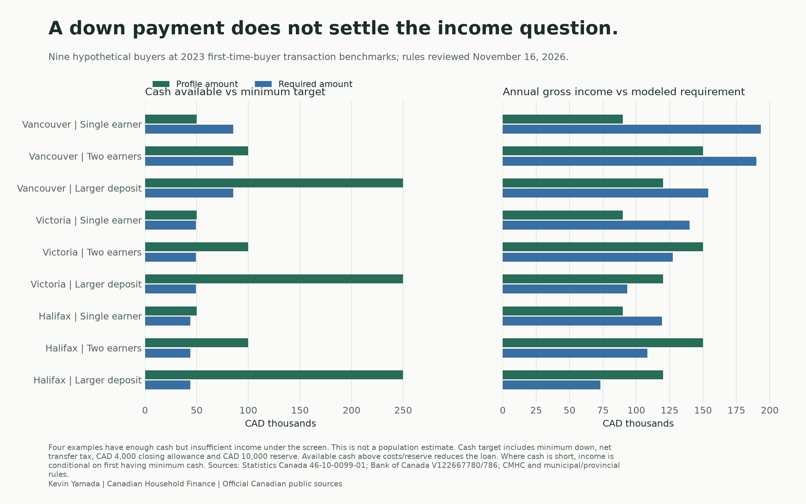

# Why does buying a home still feel out of reach?

**Is the down payment really the biggest obstacle to buying a home?**

This project separates the cash needed to buy from the income needed for the mortgage, then reviews the evidence a bank would need before signing off.

**Main finding:** four of nine buyer examples have enough cash to close but fall short of the modeled mortgage income requirement. They are hypothetical examples, not population estimates.

[Explore the interactive website](https://kevinyamada.github.io/canadian-household-finance/) · [Read the findings](reports/homebuying_findings.md) · [Bank audit case](docs/bank_audit_case.md)

## One example

Two earners have CAD 100,000 in cash and CAD 150,000 in annual gross income. At Vancouver's CAD 849,000 transaction benchmark, their minimum purchase cash plus reserve is CAD 85,360. The cash fits.

Using the remaining cash toward the mortgage, the stressed debt-service screen needs CAD 190,014 of gross income: a **CAD 40,014 income shortfall**. A 20% lower home price clears both modeled financial checks; a one-point lower mortgage rate alone does not.

**Banking audit outcome: hold.** The income exception and missing borrower/property evidence need resolution. A passed cash calculation is not a verified mortgage approval.

## Explore the work

| Deliverable | What it answers |
|---|---|
| [Interactive website](https://kevinyamada.github.io/canadian-household-finance/) | Which constraint binds in each city and buyer example? |
| [Power BI Desktop report](https://github.com/kevinyamada/canadian-household-finance/releases/download/v3.0.1/HomebuyingBarriers.pbix) | Six pages: answer, cash/income, what helps, history, waiting and bank audit |
| [Bank audit working paper](docs/bank_audit_case.md) | Would the mortgage file survive a first review? What evidence is missing? |
| [Six figures](reports/figures/homebuying/README.md) | Shareable PNG/SVG files and a six-page PDF |
| [Figure/data pack](https://github.com/kevinyamada/canadian-household-finance/releases/download/v3.0.1/HomebuyingBarriers-Figures.zip) | Figures, source tables and notes for offline review |
| [Methodology](docs/homebuying_methodology.md) | Rules, sources, assumptions, financial formulas and limits |

The website starts in light mode. Its small theme button remembers an explicit choice. City markers, profile/scenario controls and graphs select precomputed Python results; financial rules are not duplicated in browser JavaScript.

## Scope and data

Vancouver City, Victoria City and Halifax Regional Municipality use Statistics Canada resident first-time-buyer transaction data. **2023 is the latest comparable observation in the selected city series**, released in 2026. Prices are buyer-based medians across a changing property mix, not 2026 listings.

Bank of Canada national fixed five-year-and-over funds-advanced rates provide the benchmark. Mortgage and tax rules were checked November 16, 2026. Buyer finances, closing costs, reserves and carrying costs are explicit assumptions.

The research includes 468 purchase scenarios, 162 waiting scenarios, 36 buyer-measure comparisons, nine 2025-rate replays and a 2021–2023 price/rate/income decomposition. No forecast probabilities, default predictions or personal buying-date recommendations are claimed.

Data come from **Statistics Canada and official Canadian public bodies**: Bank of Canada, CMHC, FCAC, CRA, OSFI, municipal/provincial governments and Natural Resources Canada. The [manifest](data/raw/homebuying/manifest.json) preserves source URLs and hashes. The model uses 24 narrow Statistics Canada series rather than loading the entire national table.

## Banking and audit relevance

The [practice file](docs/bank_audit_case.md) connects public housing data to a bank's need for reproducible calculations, documented exceptions and verified evidence. It separates:

- Enough purchase cash from enough income to service the debt.
- An arithmetic check from independently verified borrower records.
- A public comparison screen from a lender's actual underwriting policy.

Public OSFI B-20 informs the review approach. The project uses a CMHC-style 39% GDS/44% TDS screen for comparison; uninsured lender limits may differ. This is an independent portfolio project, with no TD customer data, internal policy or endorsement.

## Reproduce in desktop VS Code

Python 3.12+; Windows required only for the native Power BI Desktop checks. The source project imports embedded data and does not require access to the author's folders.

~~~powershell
python -m venv .venv
.\.venv\Scripts\python.exe -m pip install -r requirements.txt
.\.venv\Scripts\python.exe src\homebuying_study.py
.\.venv\Scripts\python.exe src\export_homebuying.py
.\.venv\Scripts\python.exe src\build_homebuying_powerbi.py
.\.venv\Scripts\python.exe -m pytest -q
node tests\check_website.mjs
~~~

Open powerbi/HomebuyingBarriers.pbip for the editable source, or download the regular .pbix release. See the [opening guide](docs/powerbi_usage.md).

Python, SQL, plotting, browser checks and native report checks for this extension run through the local desktop VS Code terminal. No paid GPU or cloud financial analysis is needed. Use --refresh-sources only for an intentional official-data refresh; manually review changed tax and program rules.

## Project files

- [Mortgage model](src/homebuying_model.py), [official extracts](src/homebuying_data.py), [study](src/homebuying_study.py) and [audit register](src/homebuying_audit.py).
- [Independent SQL](sql/homebuying.sql), [financial/source tests](tests/test_homebuying.py) and [browser checks](tests/check_website.mjs).
- [Processed tables](data/processed) and [figure exporter](src/export_homebuying.py).
- [Power BI builder](src/build_homebuying_powerbi.py), editable report/model folders and [website](docs/index.html).

The earlier national debt-service/model experiments and renter-saving audit remain in the repository as supporting research. Their forecasts are not used to infer an individual's purchase readiness. Earlier Power BI and figure releases remain available under v2.0.0/v2.1.0.

Official statistics are adapted under their applicable open-data licences, including the [Statistics Canada Open Licence](https://www.statcan.gc.ca/en/reference/licence). Source material retains its applicable terms.
