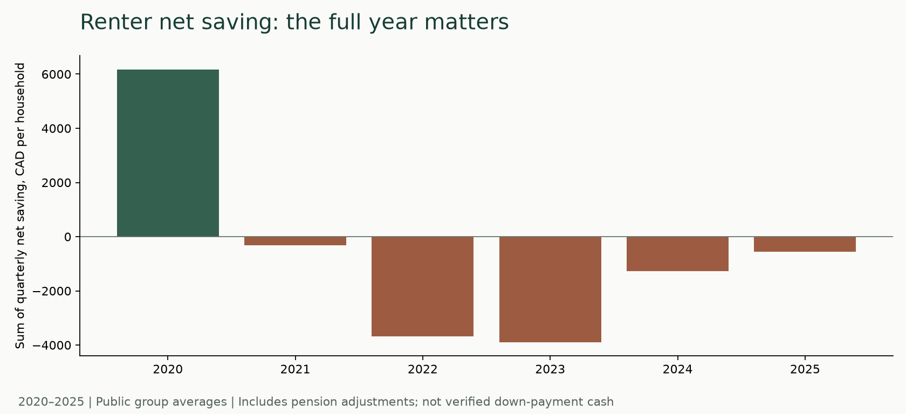

# Power BI housing-readiness audit

**Why does buying a home still feel out of reach?**

[Download the focused v2.0.0 report](https://github.com/kevinyamada/canadian-household-finance/releases/download/v2.0.0/CanadianHouseholdFinance.pbix). It opens on Audit conclusion.

## One audit trail in three pages

1. **Audit conclusion:** the headline, measured evidence and what still needs verification.
2. **Savings evidence:** full-year totals, the quarterly saving identity and audit checks.
3. **Purchase cash check:** select a price and closing allowance to inspect the upfront-cash assumptions.

The regular PBIX includes imported data. The editable project is `HouseholdFinance.pbip`. Close the source project before rebuilding with `python src/build_powerbi.py` from VS Code, reopen it and select Refresh.

The semantic model has six tables at distinct grains: summary, annual estimates, latest-year quarters, audit checks, deliberately drafted claims and purchase scenarios. They are intentionally separate. Cross-filtering within PurchaseCases connects the price and allowance choices with the cash measures. Guarded measures require one choice before displaying an assumed total.

A minimum down payment is not mortgage approval. The closing percentages and prices are explicit scenarios, and public group averages are not borrower evidence.

[Opening guide](../docs/powerbi_usage.md) · [Walkthrough](../docs/project_walkthrough.md) · [Validation](../docs/validation.md)

This figure is generated by Python, not a Power BI screenshot. The [earlier eight-page report](https://github.com/kevinyamada/canadian-household-finance/releases/download/v1.0.0/CanadianHouseholdFinance.pbix) remains available as supporting work.
