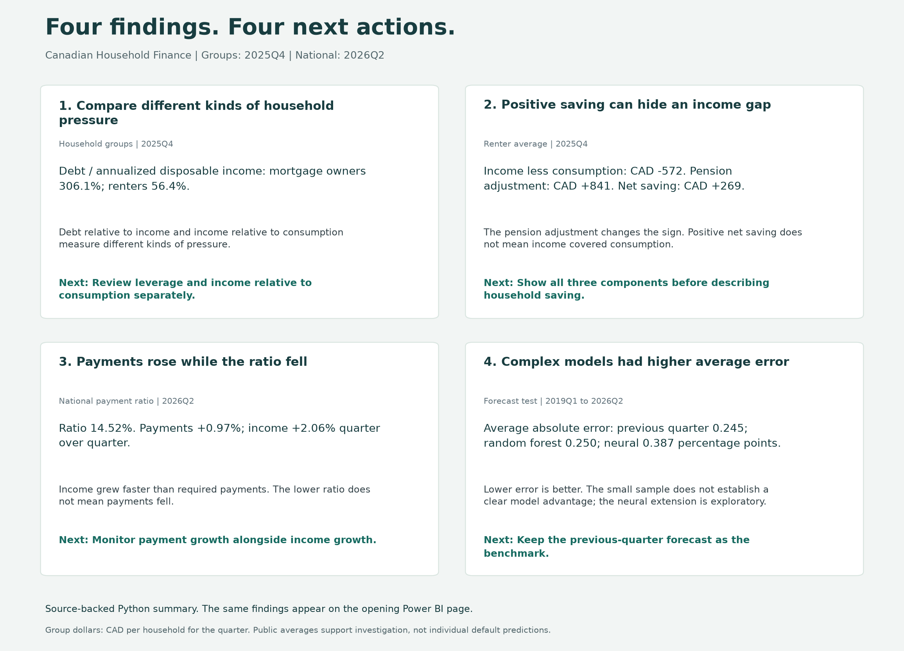
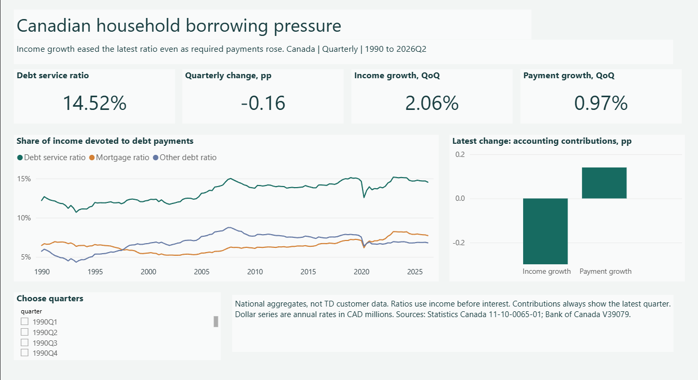
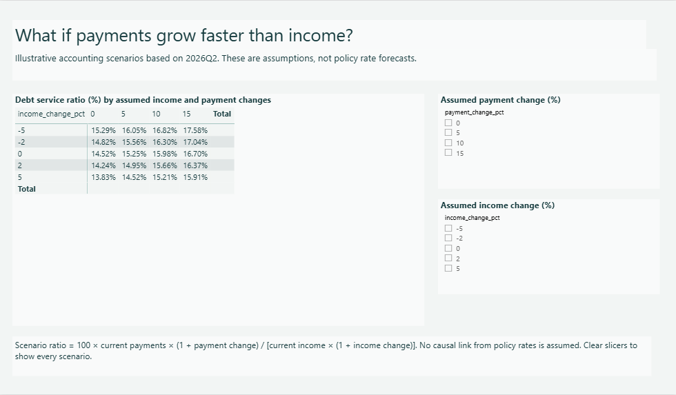
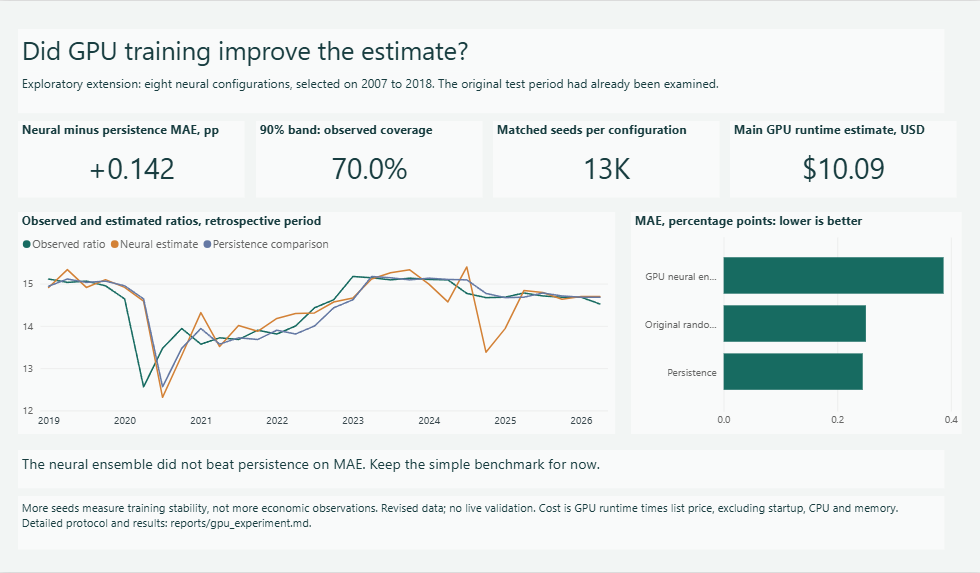
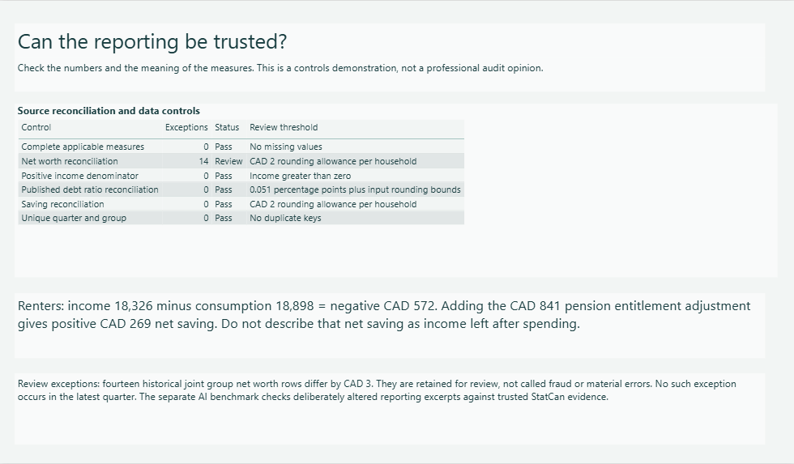
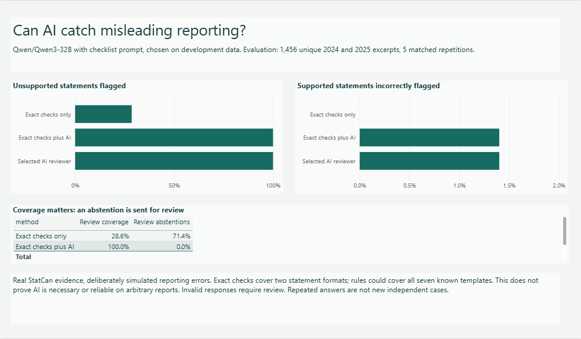

# Power BI report

**Recommended for viewing:** [Download CanadianHouseholdFinance.pbix](https://github.com/kevinyamada/canadian-household-finance/releases/latest/download/CanadianHouseholdFinance.pbix). Use the regular report file for the interview demo. See [which file to open and what the prompts mean](../docs/powerbi_usage.md).

**Editable source project:**

Open HouseholdFinance.pbip in Power BI Desktop, then select Refresh to load the embedded snapshot. Close Desktop before running run.py again. Rebuilding replaces the generated definitions and preserves old local caches in .powerbi_cache_backup. Commit manual report edits before rebuilding.

## Pages

1. Key insights: four dated findings, the evidence behind each and the next action for an analyst. This is the opening page.

2. Household groups: debt ratios and income less consumption by tenure, income and age, with the group reference period shown separately.
3. Reporting controls: six control results, retained reconciliation exceptions and the renter pension adjustment example.
4. AI reporting review: detection, false alarms and abstentions on deliberately misleading excerpts, using saved Modal results.
5. Household pressure: national ratio history, payment and income contributions, and a quarter slicer.
6. Model evaluation: observed and estimated ratios, test MAE, interval coverage and a results table.
7. Payment scenarios: an interactive matrix and slicers for assumed income and payment changes.
8. GPU experiment: the earlier neural forecasting comparison, uncertainty coverage and runtime cost.

The model uses 15 tables and 3 relationships. Quarter filters Household, Backtest and GPUBacktest in one direction. Group tables contain the frozen 2025Q4 snapshot and are intentionally separate from the national quarter slicer. Income, age and tenure describe overlapping populations; they must not be added together. Measure names are unique across the semantic model.

Power Query imports embedded JSON created from the validated Python outputs. DAX measures calculate current context values and model errors. There are no credentials, absolute file paths, custom visuals, external cloud connections, or service publishing requirements.

Optional: import theme.json through View > Themes > Browse for themes.

The generated report JSON files are checked against Microsoft's public PBIR schemas, and visual field references are checked against the semantic model. The report was opened and refreshed in Power BI Desktop 2.154.956.0. Each page's expected content and visual state was checked. Selecting payment change 10 and income change -2 returned 16.30%, matching Python. Both selections were then cleared and the report was saved on the Key insights page. See the [validation record](../docs/validation.md).

[Microsoft project documentation](https://learn.microsoft.com/en-us/power-bi/developer/projects/projects-overview)

## Insight brief and saved report previews

The opening brief is generated by Python from validated outputs. The detail images are saved previews from the previously validated Desktop report; the downloadable PBIX contains the current eight-page report.

[Plain-language walkthrough and demo script](../docs/project_walkthrough.md)

