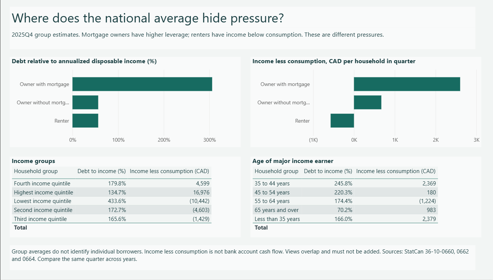

# Power BI report

Open HouseholdFinance.pbip in Power BI Desktop, then select Refresh to load the embedded snapshot. Close Desktop before running run.py again. Rebuilding replaces the generated definitions and preserves old local caches in .powerbi_cache_backup. Commit manual report edits before rebuilding.

## Pages

1. Household groups: debt ratios and income less consumption by tenure, income and age, with the group reference period shown separately.
2. Reporting controls: six control results, retained reconciliation exceptions and the renter pension adjustment example.
3. Household pressure: national ratio history, payment and income contributions, and a quarter slicer.
4. Model evaluation: observed and estimated ratios, test MAE, interval coverage and a results table.
5. Payment scenarios: an interactive matrix and slicers for assumed income and payment changes.
6. GPU experiment: the earlier neural forecasting comparison, uncertainty coverage and runtime cost.

The model uses 14 tables and 3 relationships. Quarter filters Household, Backtest and GPUBacktest in one direction. Group tables contain the latest 2025Q4 snapshot and are intentionally separate from the national quarter slicer. Income, age and tenure describe overlapping populations; they must not be added together. Measure names are unique across the semantic model.

Power Query imports embedded JSON created from the validated Python outputs. DAX measures calculate current context values and model errors. There are no credentials, absolute file paths, custom visuals, external cloud connections, or service publishing requirements.

Optional: import theme.json through View > Themes > Browse for themes.

Generated JSON is checked against Microsoft's public PBIR schemas, and visual field references are checked against the semantic model. The report was also opened and refreshed in Power BI Desktop 2.154.956.0. The original three pages were reviewed, and the added GPU page was checked against the Python results. Selecting payment change 10 and income change -2 returned 16.30%, matching Python. Both selections were then cleared and the report was saved on the overview page. See the [validation record](../docs/validation.md).

[Microsoft project documentation](https://learn.microsoft.com/en-us/power-bi/developer/projects/projects-overview)

## Desktop previews

