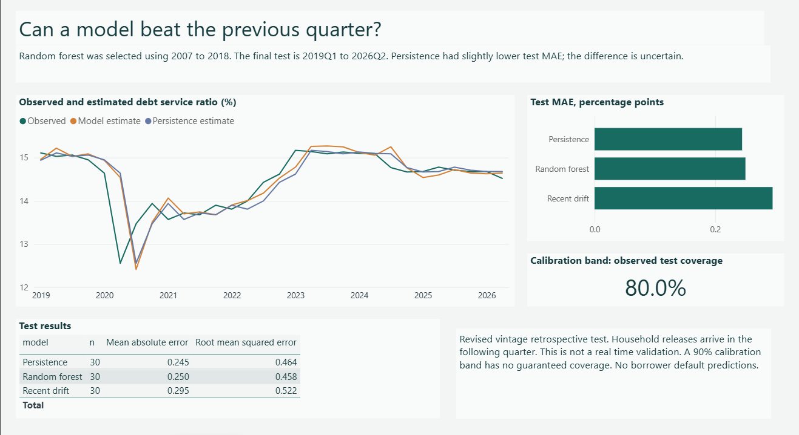

# Power BI report

Open HouseholdFinance.pbip in Power BI Desktop, then select Refresh to load the embedded snapshot. Close Desktop before running run.py again. Rebuilding replaces the generated definitions and preserves old local caches in .powerbi_cache_backup. Commit manual report edits before rebuilding.

## Pages

1. Household pressure: four KPI cards, the ratio history, an accounting decomposition and a quarter slicer. The decomposition always shows the latest published quarter.
2. Model evaluation: observed and estimated ratios, test MAE, interval coverage and a results table.
3. Payment scenarios: an interactive matrix and slicers for assumed income and payment changes.

The report uses 7 tables and 2 relationships. Quarter filters Household and Backtest in one direction. Scores, Contributions, Estimate and Scenarios are separate tables with their own grain. The headline ratio is the latest value within the selected quarters. It is never summed across quarters.

Power Query imports embedded JSON created from the validated Python outputs. DAX measures calculate current context values and model errors. There are no credentials, absolute file paths, custom visuals, external cloud connections, or service publishing requirements.

Optional: import theme.json through View > Themes > Browse for themes.

Generated JSON is checked against Microsoft's public PBIR schemas, and visual field references are checked against the semantic model. The report was also opened and refreshed in Power BI Desktop 2.154.956.0. All three pages were reviewed. Selecting payment change 10 and income change -2 returned 16.30%, matching Python. Both selections were then cleared and the report was saved on the overview page. See the [validation record](../docs/validation.md).

[Microsoft project documentation](https://learn.microsoft.com/en-us/power-bi/developer/projects/projects-overview)

## Desktop previews

