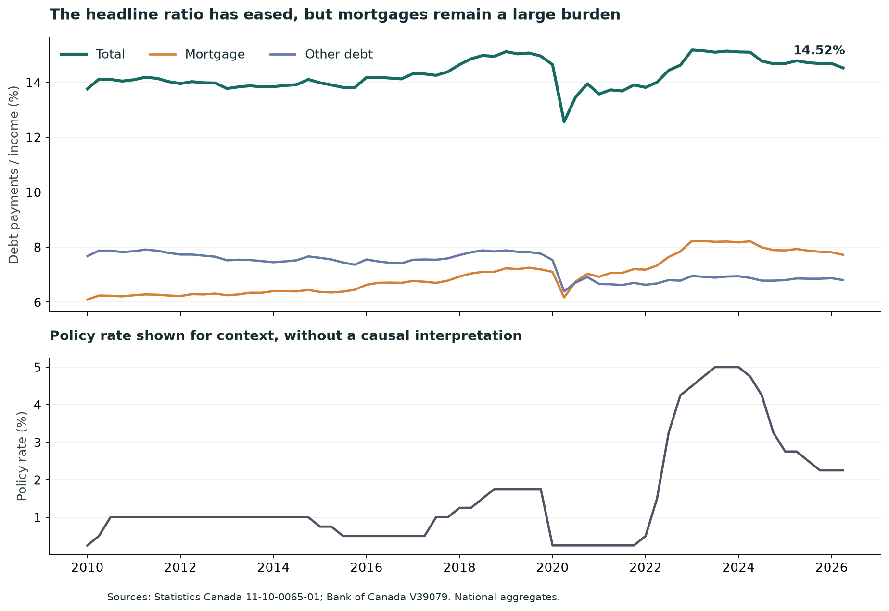
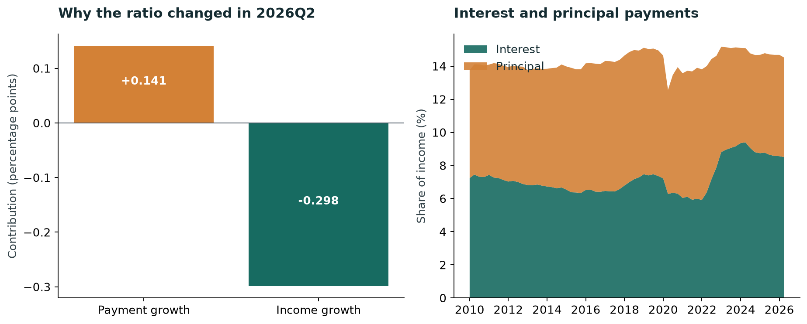
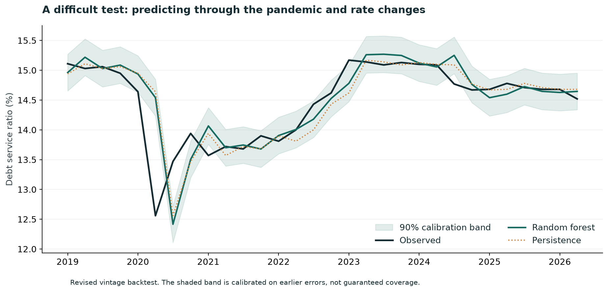
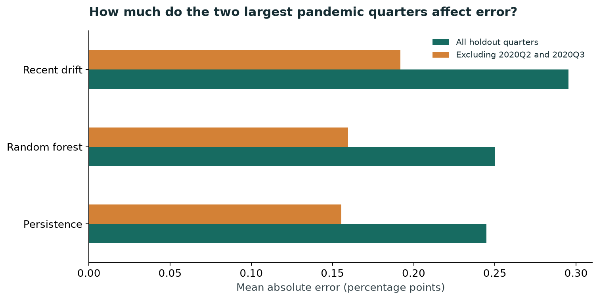
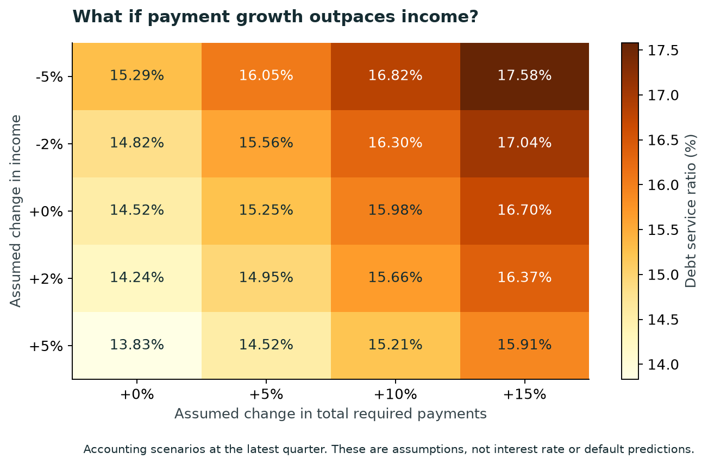

# Canadian household borrowing pressure

The national debt service ratio fell to **14.52% in 2026Q2**, a change of -0.16 percentage points from the previous quarter. Required payments still rose 0.97%. The ratio fell because income grew faster, at 2.06%.

For a bank analytics team, this supports monitoring payment growth alongside income growth. A falling aggregate ratio does not mean every household is better off or that mortgage renewal pressure has disappeared.

## What changed

The exact accounting decomposition assigns +0.141 percentage points to payment growth and -0.298 to income growth. Their sum equals the change in the unrounded ratio. This decomposition describes arithmetic, not a causal estimate.

Since 2019Q4, the mortgage component changed by +0.53 percentage points, while other debt changed by -0.96. The components share the same income denominator and can be added.

## Can a model improve the next quarter estimate?

We used 2007Q1 through 2018Q4 to choose among persistence, recent drift, three ridge settings, and a small random forest. The selected model was **Random forest**. Every prediction is fitted using only preceding labels. The final evaluation covers 2019Q1 through 2026Q2 with 30 predictions.

| Model | Quarters | MAE, percentage points | RMSE, percentage points |
| :--- | ---: | ---: | ---: |
| Persistence | 30 | 0.245 | 0.464 |
| Random forest | 30 | 0.250 | 0.458 |
| Recent drift | 30 | 0.295 | 0.522 |

The selected model did not beat persistence in the final period. Keep persistence as the practical benchmark. The selected model's relative MAE improvement over persistence was -2.3%. The paired block bootstrap interval for its MAE minus persistence is [-0.039, 0.041] percentage points. If the interval includes zero, the sample does not establish a clear advantage. There are only 30 test quarters, so the evidence is limited.

The calibration band covered 80.0% of final period observations, compared with a nominal 90% target. It is based on earlier errors from the selected model. It is not a guarantee and may miss sudden economic changes.

The next unpublished quarter, 2026Q3, has a model estimate of 14.52% with a calibration band of 14.21% to 14.83%. By the snapshot date this quarter has already ended. Treat this as a nowcast using the last published household release, not a claim of advance forecasting.

## Scenario analysis

Scenarios change required payments and income directly. They do not translate policy rate changes into mortgage payments. That would require balances, renewal dates, loan terms, and borrower data not present in these sources.

## Recommendation

Use this dashboard as an aggregate monitoring tool. Track the debt service ratio together with its payment and income components. Before using it for lending or outreach, validate the patterns with approved portfolio data at the borrower level. Do not use these aggregate results as customer default probabilities.

## Scope and limits

The dataset contains 146 quarterly national observations from 1990Q1 to 2026Q2. Dollar amounts are millions of Canadian dollars, seasonally adjusted at annual rates. They must not be described as actual quarterly cash totals. The ratio denominator adds interest back to disposable income.

Historical values can be revised. The experiment uses the current downloaded vintage, not the releases that were actually available at each historical date. Publication delays also mean quarter t household data become available during t+1. A real deployment needs release timestamps and archived vintages. Policy rates are context only and are not used in the primary model. No claim is made about TD's customers, losses, or proprietary models.

## Sources

[Statistics Canada table 11-10-0065-01](https://www150.statcan.gc.ca/t1/tbl1/en/tv.action?pid=1110006501), released September 11, 2026. [Debt service methodology](https://www150.statcan.gc.ca/n1/pub/13-605-x/2015006/article/14219-eng.htm). [Bank of Canada Valet](https://www.bankofcanada.ca/valet/docs), series V39079. Download snapshot: November 14, 2026. Source hashes are in data/raw/manifest.json.
