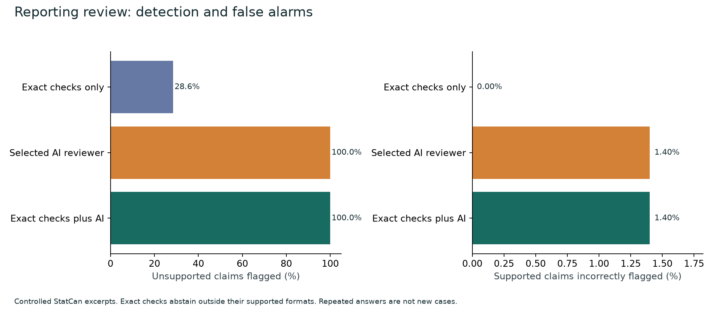

# Can AI help review financial reporting?

The selected configuration was {'model': 'Qwen/Qwen3-32B', 'prompt': 'checklist'}, chosen using development results only. Evaluation uses 1,456 unique supported and deliberately corrupted excerpts from 2024 and 2025 StatCan group data, with 5 matched generation repetitions.

| Method | Unsupported claim recall | False alarm rate | Abstention rate |
| :--- | ---: | ---: | ---: |
| Exact checks only | 28.57% | 0.00% | 71.43% |
| Selected AI reviewer | 100.00% | 1.40% | 0.00% |
| Exact checks plus AI | 100.00% | 1.40% | 0.00% |

Exact checks cover explicit ratio numbers and period statements; they send other wording for review. Their accuracy on answered cases and coverage are reported separately in audit_method_comparison.csv. A hybrid uses exact checks where applicable and the selected AI reviewer elsewhere. Invalid AI responses are abstentions, not approvals. Descriptive 95% intervals in the comparison CSV resample source quarter and group clusters, keeping related templates and repetitions together. These intervals describe the constructed benchmark, not unseen real audit work.

Use deterministic checks for facts they can validate directly. Treat AI flags as review suggestions that need a person to resolve them. The benchmark does not establish that AI can replace an auditor. Review examples of wrong or invalid model answers in audit_review_examples.json.

The source data are real Statistics Canada estimates. The incorrect excerpts are deliberately generated and labeled. Seven error families cover numbers, periods, units, ratio meaning, pension adjustments, individual claims and causality. Error prevalence is balanced by design, so precision would differ in real reports. Templates repeat across years; this is not a test of arbitrary new writing, and repeated generations do not increase the number of independent cases. The exact baseline is deliberately narrow. Rules could be written for all seven known templates, so beating this baseline does not prove that an LLM is necessary or better than a comprehensive rules system. A useful next validation would use independently reviewed real report excerpts and an expanded rules baseline.

The main workers imply US$20.02 in GPU usage from runtime at the published H100 rate. CPU model preparation, storage, setup, smoke tests and other charges are additional. This is an estimate, not an invoice. Saved outputs can be summarized without another paid run.

[Protocol](../docs/audit_protocol.md) · [Code](../experiments/modal_audit.py) · [Evaluation by error type](../data/processed/audit_error_types.csv)
