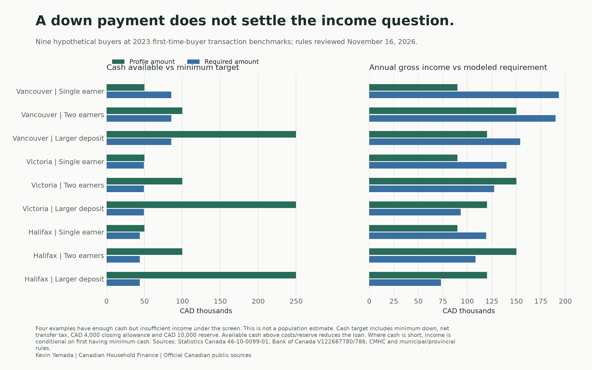
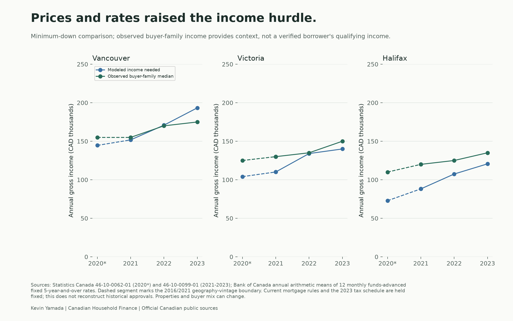
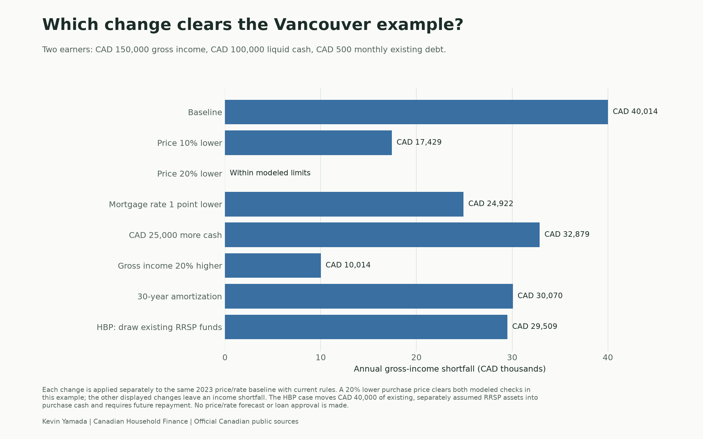
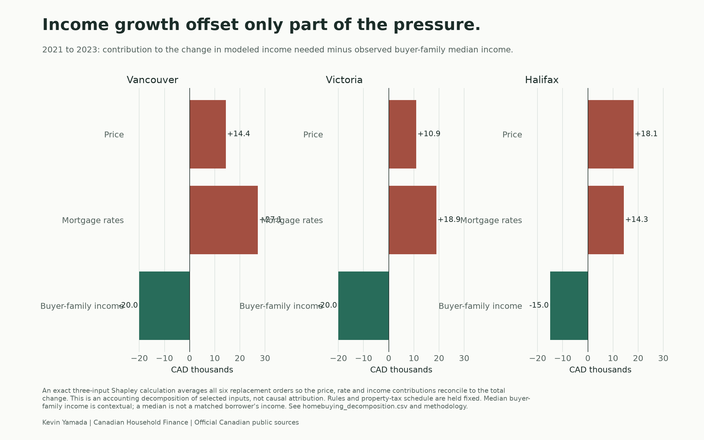
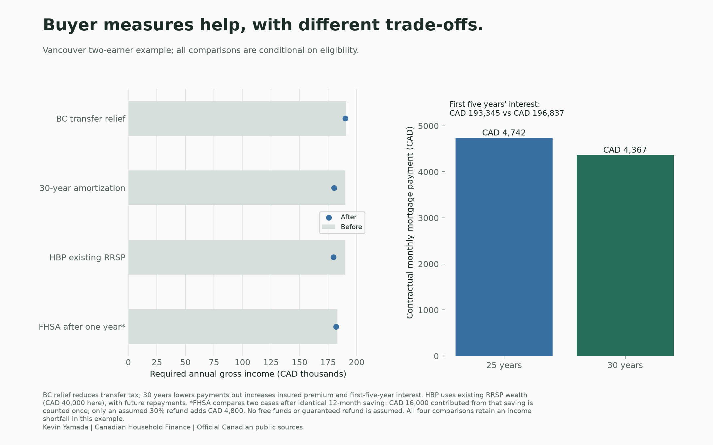
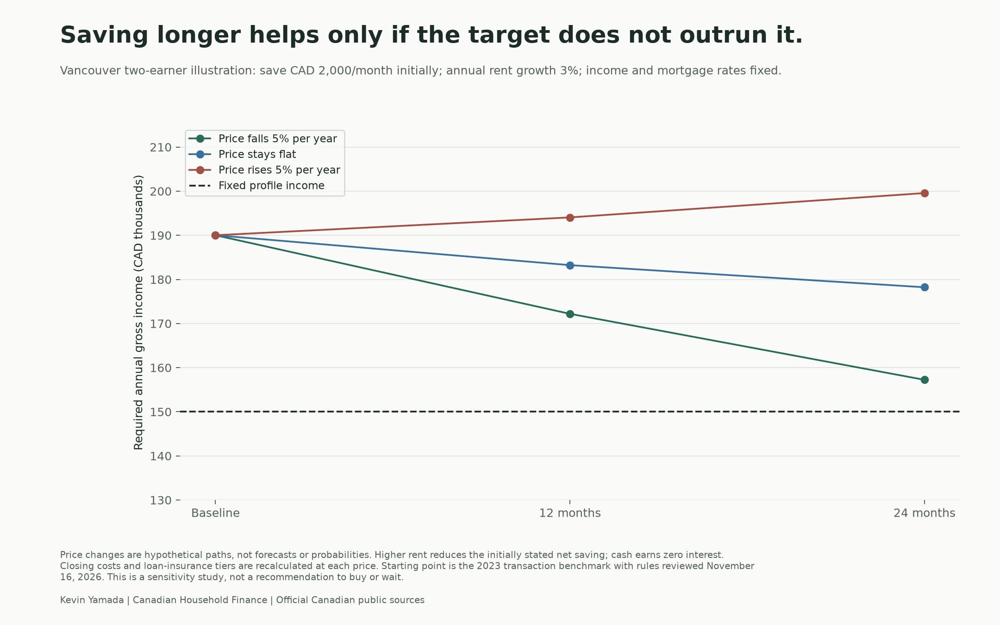

# Homebuying barriers: figure gallery

Six figures answer one question: is the down payment really the biggest obstacle?

2023 transaction benchmarks; mortgage and tax rules reviewed November 16, 2026. Buyer profiles are hypothetical, not population estimates or loan approvals.

## Cash and income

[PNG](01_cash_and_income.png) · [Editable SVG](01_cash_and_income.svg)

## Income hurdle over time

[PNG](02_income_hurdle_history.png) · [Editable SVG](02_income_hurdle_history.svg)

## What changes the result

[PNG](03_what_changes_the_result.png) · [Editable SVG](03_what_changes_the_result.svg)

## Price, rates and income

[PNG](04_price_rate_income.png) · [Editable SVG](04_price_rate_income.svg)

## Buyer measures

[PNG](05_buyer_measures.png) · [Editable SVG](05_buyer_measures.svg)

## Waiting to buy

[PNG](06_waiting_to_buy.png) · [Editable SVG](06_waiting_to_buy.svg)

[Six-page PDF](HomebuyingBarriers-Figures.pdf) · [Source tables](../../../data/processed) · [Methodology](../../../docs/homebuying_methodology.md)
