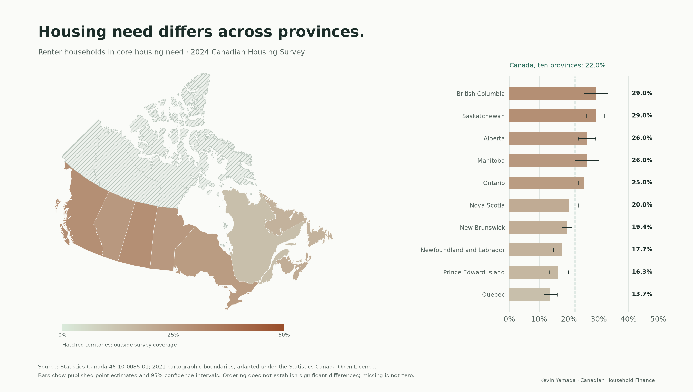
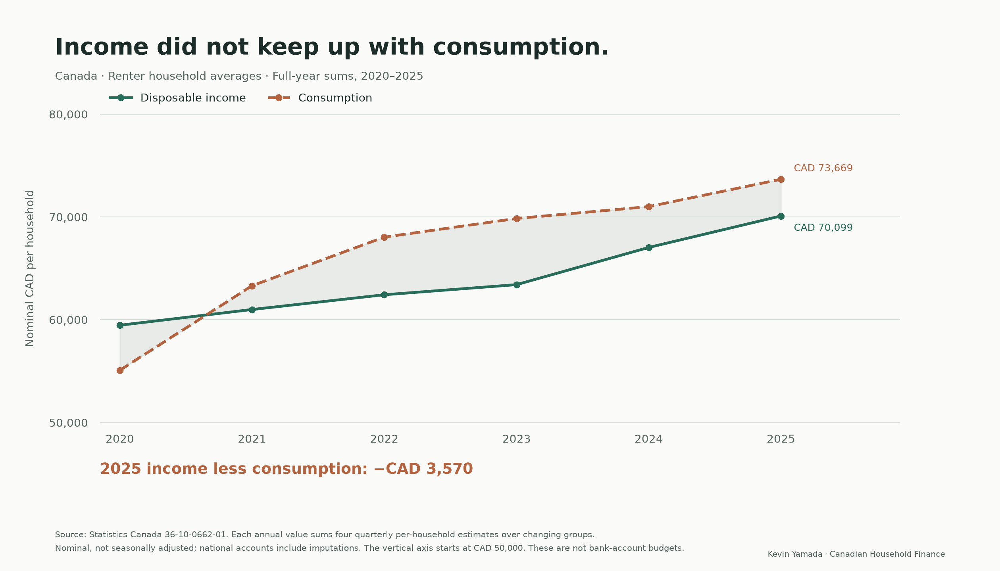
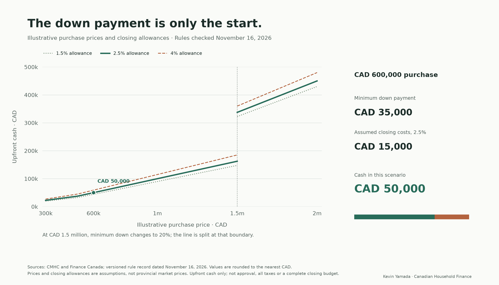
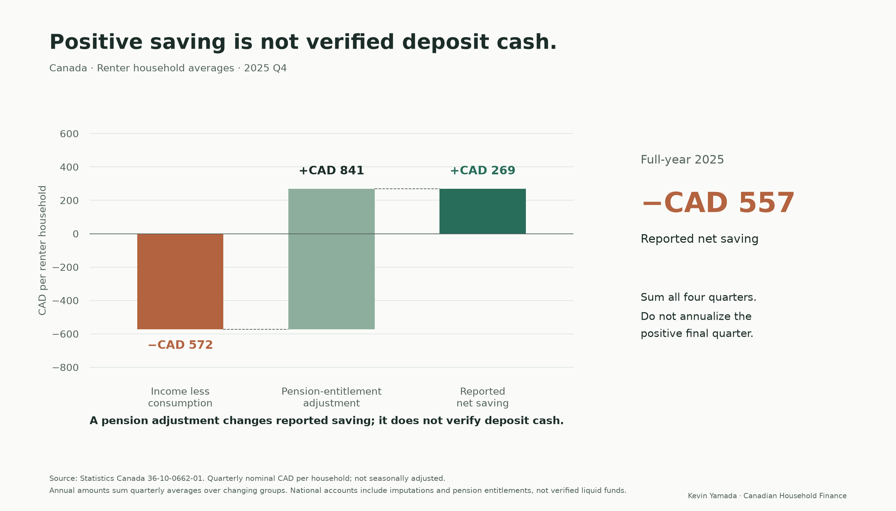

# Figures: why does buying a home still feel out of reach?

Downloadable figures from the same saved evidence used on the project website. Generated with Python and Matplotlib in local VS Code.

[Interactive website](https://kevinyamada.github.io/canadian-household-finance/) · [Four-page PDF](CanadianHouseholdFinance-Figures.pdf) · [Download pack](https://github.com/kevinyamada/canadian-household-finance/releases/tag/v2.1.0)

PNG files are for quick sharing. SVG files preserve editable text and vector paths. The ZIP also includes the source tables and hash manifest.

## Housing need differs across provinces.

Published 2024 renter-household estimates and 95% confidence intervals. The national benchmark is 22%; territories are outside coverage. Ordering is not a significance test.

[PNG](renter_housing_need.png) · [SVG](renter_housing_need.svg)

## Income did not keep up with consumption.

National renter income and consumption, 2020–2025. The 2025 accounting gap is −CAD 3,570. The figures are nominal sums of quarterly averages, not bank-account budgets.

[PNG](renter_income_consumption.png) · [SVG](renter_income_consumption.svg)

## The down payment is only the start.

Thirty saved purchase-cash scenarios. A CAD 600,000 price and 2.5% assumed closing allowance give CAD 35,000 down plus CAD 15,000 allowance. Prices are illustrative; eligibility is not estimated.

[PNG](purchase_cash.png) · [SVG](purchase_cash.svg)

## Positive saving is not verified deposit cash.

The 2025 Q4 accounting reconciliation: −572 + 841 = 269. All four quarters give −CAD 557 for 2025; the positive quarter does not prove deposit cash.

[PNG](saving_reconciliation.png) · [SVG](saving_reconciliation.svg)

## Sources and reproduction

Statistics Canada tables [46-10-0085-01](https://www150.statcan.gc.ca/t1/tbl1/en/tv.action?pid=4610008501) and [36-10-0662-01](https://www150.statcan.gc.ca/t1/tbl1/en/tv.action?pid=3610066201); Statistics Canada 2021 cartographic boundaries; current CMHC and Finance Canada purchase-rule record.

The map, national accounts and purchase scenarios cover different measures and periods. Their comparison does not establish causation or an individual buying date. Adapted Statistics Canada material uses the [Open Licence](https://www.statcan.gc.ca/en/reference/licence).

Run python src/export_figures.py in the project VS Code terminal after preparing the saved website data. See [visualization methods](../../../docs/website_visuals.md). Figure inputs and outputs are recorded in [manifest.json](manifest.json).
