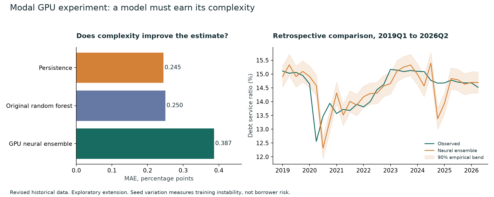

# Does a GPU neural model improve household pressure monitoring?

The business question is whether a more complex model adds useful information beyond the last published debt service ratio. A retail banking analyst needs a reliable monitoring signal, not a complicated model for its own sake.

The neural ensemble did not beat persistence on MAE. The additional GPU computation does not justify replacing the simple benchmark.

## Results

| Model | MAE, percentage points | RMSE, percentage points |
| :--- | ---: | ---: |
| Persistence | 0.245 | 0.464 |
| Original random forest | 0.250 | 0.458 |
| GPU neural ensemble | 0.387 | 0.586 |

The selected neural ensemble changed MAE by -58.1% relative to persistence, where a positive number means improvement. Its paired MAE difference was 0.142 percentage points. The descriptive 95% block bootstrap interval was [0.029, 0.287] using four quarter blocks and [0.036, 0.286] using eight quarter blocks. These short sample diagnostics do not establish future performance.

The empirical 90% band covered 70.0% of the 30 retrospective test quarters. It was calibrated using validation errors, which were also used for model selection. It has no guaranteed coverage.

## What ran on Modal

Eight H100 workers evaluated two hidden widths, two weight decay settings and two training lengths. Each model has two tanh hidden layers and predicts the next quarter change from the same eight features as the original analysis. AdamW uses learning rate 0.003. Widths are 32 and 64, weight decay is 0.01 and 0.1, and training lasts 250 or 750 epochs. This is a small exploratory grid, not an exhaustive model search.

Training windows are expanded through time. Each window has its own training only normalization and independent network parameters. Batched matrix multiplication lets the GPU fit many independent windows and seeds at once. The original data still contain only 146 quarters; parallel training does not create new observations.

The workers completed 15,652,112 individual network fits. For a fair comparison, every configuration uses the same first 12,768 random seed replicates, or 8,069,376 matched fits across 79 origins. The configuration was selected using ensemble MAE in 2007Q1 to 2018Q4. Later errors were not used to choose it. The selected configuration is {'width': 32, 'decay': 0.1, 'epochs': 250}.

The 10th to 90th percentile of individual seed test MAE was 0.370 to 0.460. That range measures sensitivity to initialization. It is not a confidence interval for the economy. The reported ensemble averages predictions across matched seeds.

## A concrete monitoring check

As an illustrative sensitivity check, a worsening quarter means a debt service ratio increase of at least 0.10 percentage points. A flag means the model predicts an increase at least that large. This threshold was specified before the GPU results and is not a bank approved policy. Precision and recall, including raw counts, are saved in gpu_comparison.csv. Persistence cannot anticipate an increase because it predicts no change. No financial loss or customer outcome is estimated from this check.

## Cost and limits

Measured main worker runtime implies approximately US$10.09 in H100 usage, or US$10.13 including the saved successful smoke test. The first smoke attempt also used about 30 GPU seconds before its result serialization failed. This estimate uses Modal's published US$0.001097 per GPU second and excludes startup, image building, CPU and memory. It is not a verified invoice. The run used a fixed compute allowance requested for this experiment; it is not a claim that this dataset needs that spend. Future refreshes can use the saved results without launching GPUs.

Each main worker has a 1,150 second work budget, a 1,180 second execution timeout, zero retries and a short scale down window. The repeated seed experiment stops by time, not by whether an attractive result appears. Partially trained batches are discarded. The source data digest, device names, runtime, settings and complete seed predictions are saved in the repository.

This experiment was designed after the original 2019 to 2026 test result was known. Its later period is therefore an exploratory retrospective comparison, not a fresh untouched test. Revised historical values and publication delays remain limitations. A future prospective evaluation using archived releases would be needed before relying on the model in a live workflow. No causal effect, borrower default probability or TD portfolio performance is claimed.

[Modal pricing](https://modal.com/pricing) · [Experiment code](../experiments/gpu_benchmark.py) · [Audit](../data/processed/gpu_audit.json)
