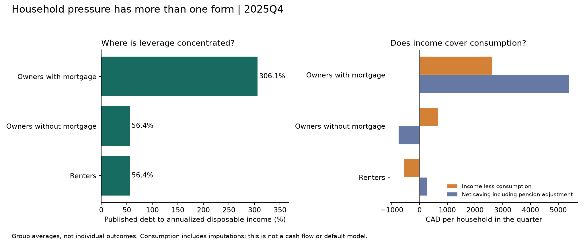

# Where household pressure is hidden by the national average

A banking analyst needs separate views of leverage and income relative to spending. A single national debt ratio cannot answer both questions.

In 2025Q4, owners with a mortgage had a debt to disposable income ratio of **306.1%**, compared with **56.4%** for renters. Yet renters' average disposable income was **CAD 572 below their consumption spending**, while mortgage owners' income exceeded consumption by **CAD 2,603**. Low debt relative to income did not imply that income covered spending.

## The reporting issue

Renters had average quarterly disposable income of CAD 18,326 and consumption of CAD 18,898. Their income less consumption was therefore negative CAD 572. Published net saving was positive CAD 269 because it also included a CAD 841 pension entitlement adjustment.

Both published figures are legitimate, but they answer different questions. Calling the CAD 269 money left over from income after spending would be misleading. Neither measure is a literal bank account cash flow: national accounts consumption includes imputations, and the subtraction does not represent all debt principal payments.

## Differences an analyst should investigate

| Group | Debt to annualized income | Income less consumption, quarterly CAD per household |
| :--- | ---: | ---: |
| Owners with mortgage | 306.1% | 2,603 |
| Owners without mortgage | 56.4% | 671 |
| Renters | 56.4% | -572 |
| Major income earner age 35 to 44 | 245.8% | 2,369 |
| Major income earner age 55 to 64 | 174.4% | -1,224 |

The age and housing groups overlap. Do not add them together or infer which individual households are struggling. Low income groups also have negative average income less consumption, but the estimates alone cannot distinguish temporary income changes, asset drawdown, borrowing and other financing responses.

## Recommendation

Use two separate monitoring views. Review mortgage balances and renewal exposure for leverage questions. Review income relative to consumption for affordability questions. For reporting, show the pension adjustment alongside net saving and preserve the source definitions. Before recommending customer actions, test these patterns using approved portfolio data rather than assuming national group averages describe the bank's borrowers.

## Audit and controls extension

The Python pipeline reconciles the published ratios and accounting identities, checks units and prevents duplicate joins. It retains fourteen historical net worth identity differences of CAD 3 for review. These small differences are not evidence of fraud or a material error. A separate AI benchmark uses deliberately altered report excerpts to test whether a language model can spot unsupported statements. Synthetic mistakes are labeled and kept apart from source data.

## Scope

These StatCan group estimates run through 2025Q4, released April 13, 2026. They are nominal and not seasonally adjusted; changes are compared with the same quarter a year earlier. They are older than the national debt service series used elsewhere in this project. The debt to income ratio is a balance divided by annualized disposable income, not a debt payment ratio. Source distributions partly rely on models and earlier surveys, so estimates have uncertainty not captured by this dashboard.

[Income and spending table](https://www150.statcan.gc.ca/t1/tbl1/en/tv.action?pid=3610066201) · [Wealth table](https://www150.statcan.gc.ca/t1/tbl1/en/tv.action?pid=3610066001) · [Published ratios](https://www150.statcan.gc.ca/t1/tbl1/en/tv.action?pid=3610066401) · [Release and limitations](https://www150.statcan.gc.ca/n1/daily-quotidien/260413/dq260413a-eng.htm)
